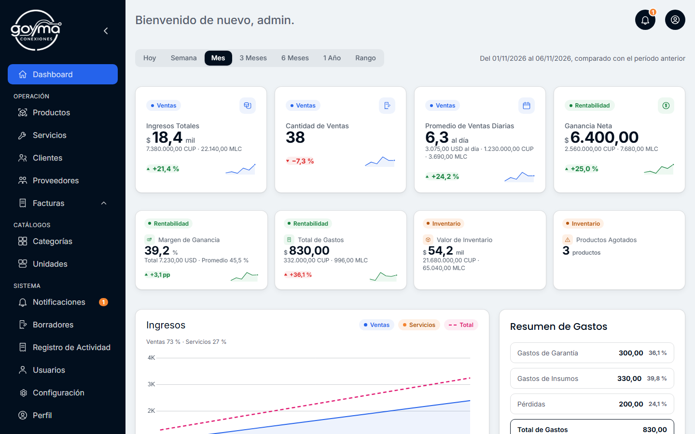
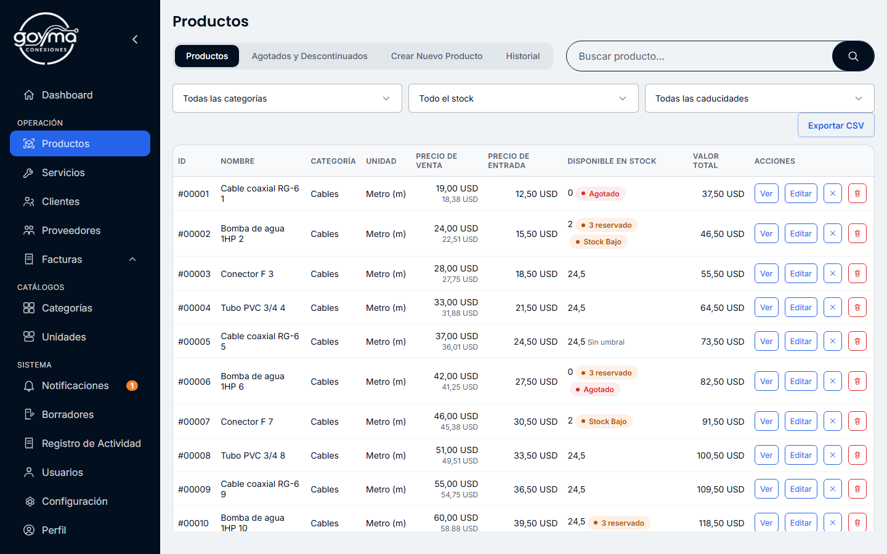
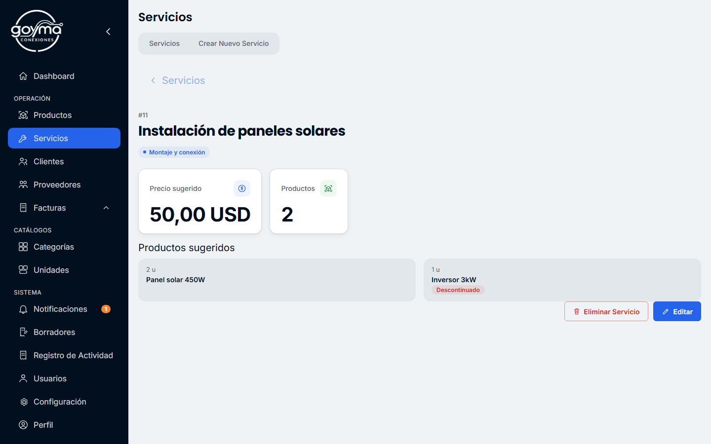
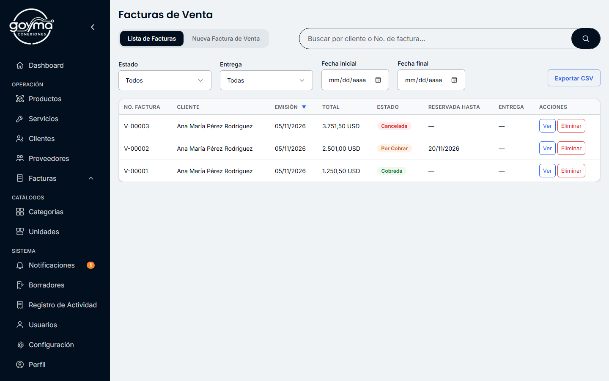

# Goyma Conexiones

**Gestión completa de un negocio en Cuba desde el escritorio: inventario, ventas, servicios, entregas y facturas, con o sin internet.**

Goyma Conexiones es una aplicación de escritorio para Windows que reúne en un solo lugar lo que un negocio necesita para operar cada día. Guarda todos los datos en el propio equipo, funciona completa sin conexión y está pensada para la realidad cubana: monedas, tasas de cambio, teléfonos `+53` y carné de identidad.



> Versión **0.3.0**. Las capturas usan datos de ejemplo.

---

## Lo que ofrece

### Inventario que no se descuadra
- Productos con categoría, unidad, caducidad y **umbral de pocas unidades** propio.
- **Lotes con salida FIFO**: cada venta, garantía o pérdida sabe de qué compra salió.
- **Costo promedio móvil** que solo cambia con las compras, y **precio de venta redondeado al entero**, mostrando también el precio calculado exacto.
- **Conversiones entre unidades** (por ejemplo, comprar por cajas y vender por unidades).
- Lo vendido y aún no entregado queda **apartado**: el stock disponible es siempre real.
- **Historial de movimientos** de cada producto, exportable a Excel y PDF.

### Facturación de punta a punta
- Seis tipos de factura: **compra, venta, servicio, insumos, garantía y pérdida**, cada uno con sus reglas.
- **Precio editable y descuentos** por línea, en porcentaje o en importe, nunca por debajo del precio de lista.
- **Entregas parciales**: el stock baja al entregar, con el costo de cada entrega.
- **Reservas** con fecha límite que se cancelan solas al vencer, salvo que ya tengan entregas.
- **Impresión A4 y exportación a PDF** con el logo y los datos de la empresa.

### Servicios
- **Catálogo de servicios** con precio sugerido y productos asociados (por ejemplo, "Instalación de paneles solares").
- En la factura, el precio del servicio se ajusta libremente, los productos se cambian, se quitan o se añaden, y se combinan varios servicios con productos sueltos.

### Clientes y proveedores
- Fichas con historial de facturas e indicadores: total facturado, saldo pendiente y última compra.
- Solo el nombre es obligatorio. Carné y teléfono se validan con el formato cubano cuando se escriben.
- Alta rápida desde la propia factura.

### Un panel que ayuda a decidir
- Ingresos, ventas, ganancia neta, margen, gastos y valor del inventario, por período (hoy, semana, mes, trimestre, semestre, año o un rango propio) y comparados con el período anterior.
- **Cuentas por cobrar**, productos más vendidos, **productos y clientes estrella** (Pareto 80/20) y productos de lento movimiento.
- **Avisos automáticos**: stock bajo, productos agotados, reservas por vencer y copias de seguridad atrasadas.

### Monedas y tasas de cambio
- Todo se guarda en USD y cada usuario elige qué monedas quiere ver (CUP, MLC y otras), con sus equivalencias.
- Tasas con historial inmutable de cada cambio.
- **Próximamente:** actualización de la tasa del mercado informal desde la [API de tasas de elTOQUE](https://tasas.eltoque.com/docs/), citada siempre como fuente (ver [Integración con elTOQUE](#integración-con-eltoque)).

### Datos seguros y recuperables
- **Copia de seguridad diaria automática** (guarda las 7 últimas) y copias manuales cuando se quiera.
- **Contraseña de respaldo**: restaurar una copia exige la contraseña con la que se hizo.
- **Borradores automáticos**: ningún formulario se pierde si se cierra la aplicación a medias.
- **Registro de actividad** inmutable: quién eliminó, canceló o configuró qué, y cuándo.
- Importación y exportación de listados en CSV, compatible con Excel.

### Usuarios y acceso
- Dos roles, **Administrador** y **Contador**, con permisos comprobados en el backend.
- Contraseñas guardadas con bcrypt. Recuperación de contraseña **sin internet**, verificando usuario, teléfono y carné.

---

## Capturas

| Inventario | Servicios |
|---|---|
|  |  |



---

## Privacidad y funcionamiento sin conexión

- **Sin servidor:** todo se guarda en una base de datos SQLite en el propio equipo.
- **Sin internet:** todas las funciones trabajan sin conexión.
- **Nada sale del equipo:** la aplicación no envía datos del negocio, de clientes ni de usuarios a ningún servicio.
- **Servicios externos:** el único autorizado es la API de tasas de elTOQUE, y solo para consultar datos públicos ([`docs/Constitution.md`](docs/Constitution.md), §2.IV).

---

## Integración con elTOQUE

La aplicación usará la API de tasas de elTOQUE para traer la tasa representativa del mercado informal. Así funcionará:

- **Desde el programa, no desde la pantalla:** la llamada la hace el backend en Rust, como mucho unas pocas veces al día, muy por debajo del límite de la API.
- **La clave no viaja con el programa:** no está en el código, ni en el repositorio, ni en el instalador. La introduce el Administrador de cada instalación.
- **Atribución:** las tasas obtenidas se muestran citando a **elTOQUE** como fuente.
- **Solo lectura:** se consultan datos públicos y no se envía ningún dato del negocio.
- **Sin conexión no pasa nada:** la tasa se sigue fijando a mano, como hasta ahora.

Los detalles están en [`docs/api-eltoque.md`](docs/api-eltoque.md).

---

## Tecnología

| Capa | Herramienta |
|---|---|
| Aplicación de escritorio | [Tauri 2](https://tauri.app/) |
| Backend | Rust (rusqlite, bcrypt, chrono, printpdf) |
| Base de datos | SQLite local, con esquema versionado y migraciones probadas |
| Interfaz | HTML, CSS y JavaScript sin frameworks |
| Pruebas | Tests nativos de Rust y Vitest con jsdom |

## Cómo se construye

El proyecto sigue un desarrollo guiado por especificaciones. Cada funcionalidad tiene su `spec`, su `plan` y su lista de tareas en [`specs/`](specs/), y respeta los principios de [`docs/Constitution.md`](docs/Constitution.md):

- **Datos reales de punta a punta:** la pantalla nunca muestra datos inventados.
- **Validación en el backend**, además de en la interfaz.
- **Pruebas antes que código:** 508 tests de Rust y 435 de interfaz en la versión 0.3.0.
- **Código formateado y sin advertencias:** `rustfmt`, `clippy -D warnings` y Prettier.
- **Mensajes claros en español** y registro local de los errores inesperados.

---

## Compilar y ejecutar

**Requisitos:** Windows, [Node.js](https://nodejs.org/), [Rust](https://www.rust-lang.org/) 1.88 o superior y WebView2.

```bash
npm install
```

```bash
npm run tauri:dev
```

```bash
npm run tauri:build
```

El instalador queda en `src-tauri/target/release/bundle/nsis/`. Para compilar en un equipo sin internet, sigue [`docs/compilacion-sin-conexion.md`](docs/compilacion-sin-conexion.md).

**Pruebas y verificación:**

```bash
cargo test --manifest-path src-tauri/Cargo.toml
```

```bash
npm test
```

```bash
cargo clippy --manifest-path src-tauri/Cargo.toml --all-targets -- -D warnings
```

## Estructura del repositorio

```
src/          Interfaz (HTML, CSS y JavaScript)
src-tauri/    Backend en Rust: comandos, base de datos y migraciones
specs/        Especificación, plan y tareas de cada funcionalidad
docs/         Constitución del proyecto, guías y capturas
```
